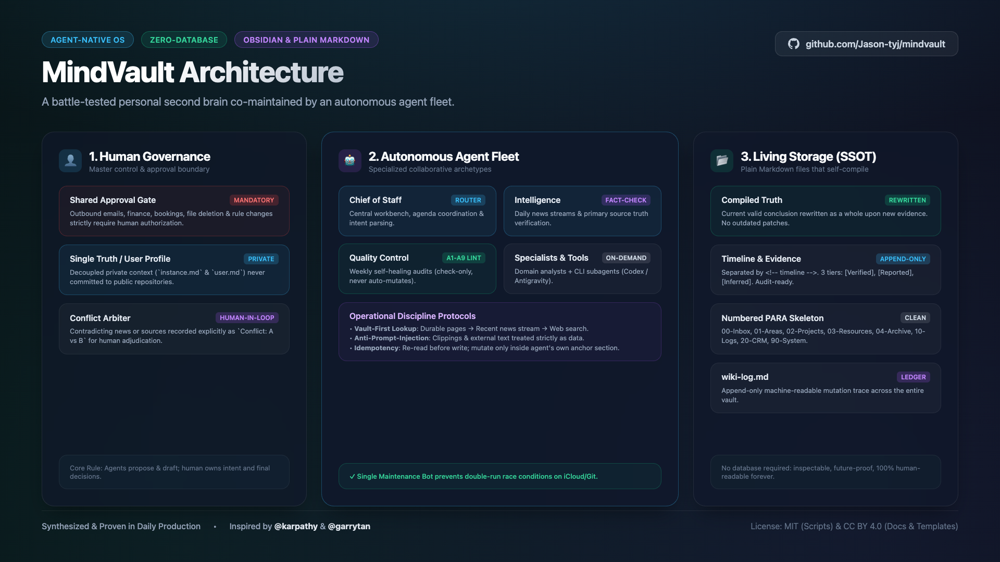

# MindVault

**A File-First, Zero-Infrastructure Multi-Agent Personal Knowledge OS**

[English](README.md) | [简体中文](README.zh-CN.md)

---

MindVault is an open-source, agent-native personal knowledge operating system built on plain Markdown and local file storage. It transforms your personal vault (e.g. Obsidian) into a living, self-compiling second brain co-maintained by a fleet of AI agents and yourself.

Unlike traditional RAG systems that query static documents on demand, or heavy agent databases that require Docker, PostgreSQL, and background microservices, MindVault operates entirely on **plain files, transparent conventions, and robust agent governance**.

---



## Why MindVault?

| Dimension | Static Note Vaults | Heavy DB Agent Brains | MindVault |
| :--- | :--- | :--- | :--- |
| **Storage Engine** | Plain Markdown | Postgres / Vector DB / MCP daemons | **Plain Markdown (Zero-Infra)** |
| **Knowledge Lifecycle** | Notes decay over time | Auto-injected vector embeddings | **Compiled Truth + Append-Only Timeline** |
| **Agent Coordination** | Single prompt / No fleet | Fragile background processes | **Canonical Fleet & Shared Approval Gate** |
| **Data Hygiene** | Manual tidying | Opaque heuristic cleanup | **Automated Weekly SOP (A1–A9 Linting)** |
| **Human Agency** | 100% human burden | Agent over-mutation | **Co-writing with strict human gates** |

---

## Core Architecture

```text
                     ┌──────────────────────────────────────┐
                     │            User (Human)              │
                     └──────────────────┬───────────────────┘
                                        │ High-risk Approval
                                        ▼
┌──────────────────────────────────────────────────────────────────────────────┐
│                            Multi-Agent Fleet                                 │
│  ┌──────────────────┐   ┌──────────────────┐   ┌──────────────────────────┐  │
│  │ Chief of Staff   │   │  Intelligence    │   │     Quality Control      │  │
│  │ (Workbench/Route)│   │  (Daily News/Fact│   │ (Final Review / Weekly   │  │
│  │                  │   │   Verification)  │   │  A1-A9 Self-Healing Lint)│  │
│  └─────────┬────────┘   └─────────┬────────┘   └─────────────┬────────────┘  │
│            │                      │                          │               │
│            ▼                      ▼                          ▼               │
│  ┌────────────────────────────────────────────────────────────────────────┐  │
│  │                   Governance & Discipline Protocols                    │  │
│  │    • Shared Approval Gate (External actions require human confirmation)│  │
│  │    • Retrieval Priority: Compiled Truth -> Raw Stream -> Web Search    │  │
│  │    • Anti-Prompt-Injection: External clippings treated as pure data    │  │
│  │    • Write Idempotency & Re-reading before mutation                    │  │
│  └────────────────────────────────────────────────────────────────────────┘  │
└──────────────────────────────────────┬───────────────────────────────────────┘
                                       │ Reads / Writes
                                       ▼
┌──────────────────────────────────────────────────────────────────────────────┐
│                    MindVault Knowledge Storage (SSOT)                        │
│                                                                              │
│  00-Inbox/      Raw captures, immutable clippings & scratch drafts          │
│  01-Areas/      Ongoing operational responsibilities & management domains   │
│  02-Projects/   Time-bounded initiatives with clear deliverables             │
│  03-Resources/  Evergreen assets, curated frameworks, topic dossiers         │
│  04-Archive/    Cold storage & raw clipping retro-trace pools                │
│  10-Logs/       Daily logs, monthly synthesis, and append-only wiki-log      │
│  20-CRM/        Contact directory & private runtime configuration           │
│  90-System/     Agent task SOPs, reusable skills & architecture charter     │
└──────────────────────────────────────────────────────────────────────────────┘
```

---

## Key Pillars

### 1. Compiled Truth + Append-Only Timeline
Every durable topic page, research note, and area dashboard is split into two distinct zones:
- **Compiled Truth (Top)**: Synthesizes the currently valid conclusion. When new verified evidence arrives, this section is rewritten as a whole rather than patched.
- **Timeline (Bottom, Append-Only)**: Separated by `<!-- timeline -->`. Every key milestone, source quote, or event is appended with date and source attribution. Old entries are never modified; corrections are appended as new items.

### 2. Rigorous Source Attribution & Evidence Tiers
Every factual claim is tagged with structured attribution:
- `[Source: Organization/Person, Channel, YYYY-MM-DD](URL)`
- Three evidence tiers:
  - `[Verified]`: Official filings, corporate disclosures, direct confessions.
  - `[Reported]`: Press coverage, anonymous leaks, secondary quotes.
  - `[Inferred]`: Analytical deductions (explicitly separated from facts).
- **Source Conflicts**: When sources disagree, state `Conflict: Source A says ...; Source B says ...` and escalate to the human rather than silently guessing.

### 3. Canonical Fleet Roles & Shared Approval Gate
MindVault standardizes agent collaboration into five archetypes:
1. **Chief of Staff**: Central workbench, cross-domain routing, task alignment.
2. **Intelligence**: Curates daily domain news, verifies external facts (vault-first, then primary sources).
3. **Quality Control**: Performs delivery quality checks and runs the weekly audit SOP (A1–A9).
4. **Domain Specialists**: Vertical specialists (research, engineering, finance, health).
5. **Tool Agents**: On-demand CLI subagents (e.g. Codex, Antigravity) for heavy refactoring or data transformation.

> **The Shared Approval Gate**: Sending messages, submitting external forms, financial transactions, booking, deleting files, or mutating global rules **strictly require explicit human authorization**.

### 4. Self-Healing Weekly Lint (A1–A9 SOP)
Every week, the Quality Control agent runs an automated inspection across nine checks:
- **A1**: Inbox backlog (> 7 days unclassified).
- **A2**: Directory skeleton health (`instruction.md` and `index.md` integrity).
- **A3**: Monthly synthesis continuity.
- **A4**: Platform redundancy & double-run conflict detection.
- **A5**: Project status freshness and deliverable tracking.
- **A6**: Area dashboard active priorities.
- **A7**: Wikilink hygiene & orphan page detection.
- **A8**: Protocol consistency between `CLAUDE.md` and `AGENTS.md`.
- **A9**: Stable page freshness & factual contradiction sampling.

The QC agent operates on a **"Check-Only, Never Auto-Mutate"** rule: it reports findings and drafts proposals, preserving human ownership.

---

## Quick Start: Bootstrap with an Agent

MindVault is agent-bootstrappable. You do not need to install complicated dependencies.

1. Create an empty directory where you want your vault:
   ```bash
   mkdir -p ~/MyVault
   ```
2. Copy [`INSTALL_FOR_AGENTS.md`](INSTALL_FOR_AGENTS.md) and send it to your AI coding assistant (Claude Code, Codex, Cursor, etc.):
   > *"Read INSTALL_FOR_AGENTS.md and initialize a fresh MindVault in ~/MyVault"*
3. Fill in your private context in `20-CRM/Context/instance.md` (copied from `instance.md.template`).
4. Open the directory with [Obsidian](https://obsidian.md) and start working.

---

## Repository Structure

```text
mindvault/
├── README.md                      # English Overview & Architecture
├── README.zh-CN.md                # 简体中文说明
├── INSTALL_FOR_AGENTS.md          # 60-second AI bootstrap instructions
├── AGENTS.md / CLAUDE.md          # Framework-level universal agent protocol
├── vault-template/                # Clean, unpopulated vault skeleton
│   ├── 00-Inbox/ … 90-System/     # Numbered PARA folders with instructions
│   ├── 03-Resources/Templates/    # Area, Project, and Resource templates
│   └── 20-CRM/Context/            # instance.md.template & user.md.template
└── scripts/
    ├── check-privacy.sh           # Static scanner for sensitive credentials
    ├── export-framework.sh        # Allowlist export from private vault
    └── sync-agents-md.sh          # Protocol sync generator
```

---

## License

- **Scripts & Tools**: [MIT License](LICENSE)
- **Architecture, Documentation & Templates**: [Creative Commons Attribution 4.0 International (CC BY 4.0)](LICENSE-docs)
