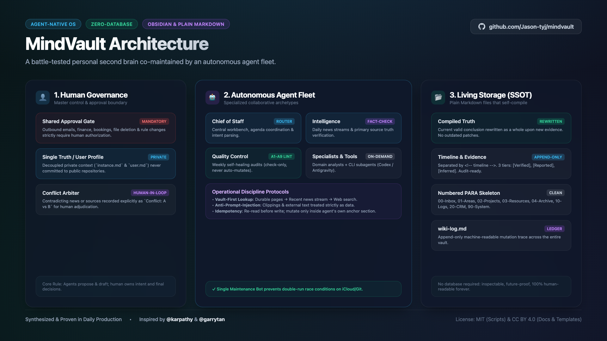

# MindVault

**面向多智能体（Multi-Agent）编队的轻量级个人知识操作系统**

[English](README.md) | [简体中文](README.zh-CN.md)

---

MindVault 是一个开源、智能体原生（Agent-Native）的个人知识操作系统，建立在纯 Markdown 文件与本地存储之上。它将个人笔记库（如 Obsidian）升级为一个具有**自编译保鲜能力、由人类与多智能体编队共同维护的第二大脑**。

不同于单向检索的传统 RAG，也不同于依赖 Docker、PostgreSQL、pgvector 和后台守护进程的重型智能体记忆数据库，MindVault 坚持 **纯文本优先（File-First）、零基础设施依赖（Zero-Infra）与严密的人机协作治理纪律**。

---



## 为什么选择 MindVault？

| 维度 | 传统静态笔记库 | 重型数据库 Agent 记忆 | MindVault |
| :--- | :--- | :--- | :--- |
| **底层存储** | 本地 Markdown | Postgres / 向量数据库 / MCP 进程 | **纯 Markdown 文件（零基础设施）** |
| **知识生命周期** | 存入后随时间陈旧断更 | 机械切片注入，难以直接审查 | **编译结论（整段重写）+ 只追加时间线** |
| **编队协同** | 无多智能体调度与边界 | 易发生后台并发写入与死锁 | **标准角色原型 + 共享人类审批线** |
| **知识库自洁** | 依赖人类手动整理 | 黑盒启发式清理，不可见 | **每周 SOP 自动体检（A1–A9 只检不修）** |
| **主权与安全** | 人类负担重 | AI 擅自修改核心判断 | **人机共写、数据防注入与单向安全隔离** |

---

## 系统核心架构

```text
                     ┌──────────────────────────────────────┐
                     │              用户 (Human)            │
                     └──────────────────┬───────────────────┘
                                        │ 审批高危/对外操作
                                        ▼
┌──────────────────────────────────────────────────────────────────────────────┐
│                           多智能体协作编队 (Fleet)                            │
│  ┌──────────────────┐   ┌──────────────────┐   ┌──────────────────────────┐  │
│  │ 参谋长 (Chief)   │   │ 情报官 (Intel)   │   │     质检师 (QC)          │  │
│  │ 工作台/协调/路由 │   │ 资讯日更/一手核查│   │ 交付终检 / 周度巡检 SOP   │  │
│  │                  │   │ 先查库再联网     │   │ (A1–A9 只检不修自愈机制) │  │
│  └─────────┬────────┘   └─────────┬────────┘   └─────────────┬────────────┘  │
│            │                      │                          │               │
│            ▼                      ▼                          ▼               │
│  ┌────────────────────────────────────────────────────────────────────────┐  │
│  │                     协同纪律与安全约束协议 (Protocols)                 │  │
│  │    • 编队共享审批线（发信/付款/订票/删除/改全局规则必须人类确认）       │  │
│  │    • 检索优先级：库内稳定页/专题页 -> 资讯流原始层 -> 实时联网核对     │  │
│  │    • 外部内容防提示词注入：剪藏/网页指令一律视为只读数据                 │  │
│  │    • 写入幂等与纪律：写前重新读取、专属锚点小节写入、大改先做备份       │  │
│  └────────────────────────────────────────────────────────────────────────┘  │
└──────────────────────────────────────┬───────────────────────────────────────┘
                                       │ 读取 / 写入
                                       ▼
┌──────────────────────────────────────────────────────────────────────────────┐
│                    MindVault 知识存储中枢 (单一事实源 SSOT)                   │
│                                                                              │
│  00-Inbox/      临时收集箱，网页剪藏（不可变原始层）与自发草稿               │
│  01-Areas/      长期责任领域（业务线、技术架构、团队管理、个人健康）         │
│  02-Projects/   在建项目（明确交付物与截止期，命名 `YYYYMM-序号-项目名`）     │
│  03-Resources/  专题资产库、方法论、资讯流简报、卡片模板库、提示词           │
│  04-Archive/    冷存储归档池（已完结项目、历史日记与剪藏原文回溯池）         │
│  10-Logs/       工作流水事件总线：Daily 日记、Monthly 汇总与 wiki-log 变更日志│
│  20-CRM/        人脉协作网络、Owner 背景画像与本地私有实例环境覆盖配置       │
│  90-System/     系统支撑：自动化任务卡 SOP、可版本化技能与体系宪章           │
└──────────────────────────────────────────────────────────────────────────────┘
```

---

## 核心设计支柱

### 1. 稳定页解剖学：编译结论 + 只追加时间线
所有核心研究卡、业务工作台与专题页均分为上下两段：
- **当前结论（Compiled Truth）**：页身上半部分，提炼截至此刻仍然成立的研判。证据发生关键变化时整段重写，杜绝在过时现状上打补丁。
- **时间线（Timeline，只追加）**：以 `<!-- timeline -->` 分隔，下方每条事实均带日期与信源。永不改写历史旧条，发现错误追加一条“更正：…”，形成完整的演进证据链。

### 2. 规范化溯源、三级证据与冲突显式呈现
所有事实性陈述必须标注信源与证据等级：
- 引用格式：`[来源：机构/人, 渠道, YYYY-MM-DD](URL)`
- 证据三档：
  - `【已证实】`：官方公报、SEC 8-K 文件、当事人公开承认；
  - `【报道】`：权威媒体引述、匿名知情人士爆料；
  - `【推断】`：分析师与我们的推导判断（严禁与事实混淆）。
- **信源冲突**：当多方信源不一致时，严格记录为 `冲突：A 说…［来源］；B 说…［来源］`，交由人类裁决，禁止 AI 擅自隐蔽选择。

### 3. 标准化编队角色与共享审批线
MindVault 将个人 AI OS 的多智能体协作固化为 5 类原型：
1. **参谋长 (Chief of Staff)**：日常工作台总控、意图解析与跨 Agent 任务对齐；
2. **情报官 (Intelligence)**：行业与科技资讯日更、一手信源核实（查库优先）；
3. **质检师 (Quality Control)**：方案终审、周度合规巡检与知识库自愈；
4. **领域专家原型 (Specialists)**：投研、研发管理、运动健康等垂直领域深钻；
5. **工具型代理 (Tool Agents)**：本地 CLI 大代码工程处理（如 Codex、Antigravity）。

> **共享审批线（Shared Approval Gate）**：对外发送消息、提交系统表单、资金支付、差旅预订、删除文件、修改全局规则等破坏性操作，**一律必须经人类明确授权**。

### 4. 闭环周度巡检 SOP（A1–A9 自愈机制）
每周日由质检师全自动执行结构与逻辑巡检（坚守**“只检不修”**原则，仅出报告不擅自改库）：
- **A1**：Inbox 逾龄滞留检查（超过 7 天未决提报规则缺口）；
- **A2**：目录骨架完整性（`instruction.md` / `index.md` 覆盖率）；
- **A3**：月度汇总缺口检查；
- **A4**：多平台调度双跑与任务卡漂移检查；
- **A5**：项目卡状态新鲜度与下一步行动检查；
- **A6**：Area 工作台重点追踪项；
- **A7**：双链卫生检查与孤儿页检测；
- **A8**：`CLAUDE.md` 与 `AGENTS.md` 规则一致性校验；
- **A9**：稳定页事实新鲜度抽样与矛盾事实探查。

---

## 快速建库（交给 Agent 60 秒初始化）

无需安装复杂的数据库或依赖环境：

1. 创建您的新知识库空目录：
   ```bash
   mkdir -p ~/MyVault
   ```
2. 将 [`INSTALL_FOR_AGENTS.md`](INSTALL_FOR_AGENTS.md) 文件的内容完整发送给任意具备文件能力的 AI 助手（Claude Code、Codex、Cursor、Gemini CLI 等）：
   > *“请阅读 INSTALL_FOR_AGENTS.md，在 ~/MyVault 目录下初始化全新的 MindVault 架构”*
3. 打开生成后的目录，将 `20-CRM/Context/instance.md.template` 另存为 `instance.md`，填入您的机器环境与模型偏好。
4. 使用 [Obsidian](https://obsidian.md) 打开该目录，即可开始体验。

---

## 仓库结构

```text
mindvault/
├── README.md                      # 英文项目总览与架构
├── README.zh-CN.md                # 简体中文使用指引
├── INSTALL_FOR_AGENTS.md          # 60 秒智能体建库提示词蓝图
├── AGENTS.md / CLAUDE.md          # 框架级通用智能体系统协议
├── vault-template/                # 空白去个人化知识库模板
│   ├── 00-Inbox/ … 90-System/     # 标准编号 PARA 结构与各目录说明书
│   ├── 03-Resources/Templates/    # Area、Project、Resource 核心卡片模板
│   └── 20-CRM/Context/            # instance.md.template 与 user.md.template
└── scripts/
    ├── check-privacy.sh           # 静态脱敏与敏感信息扫描脚本
    ├── export-framework.sh        # 私库到公开库的白名单导出脚本
    └── sync-agents-md.sh          # 跨 Agent 协议自动同步脚本
```

---

## 许可证说明

- **工具脚本代码**：采用 [MIT License](LICENSE)
- **知识库架构、文档与模板**：采用 [知识共享署名 4.0 国际许可协议 (CC BY 4.0)](LICENSE-docs)
